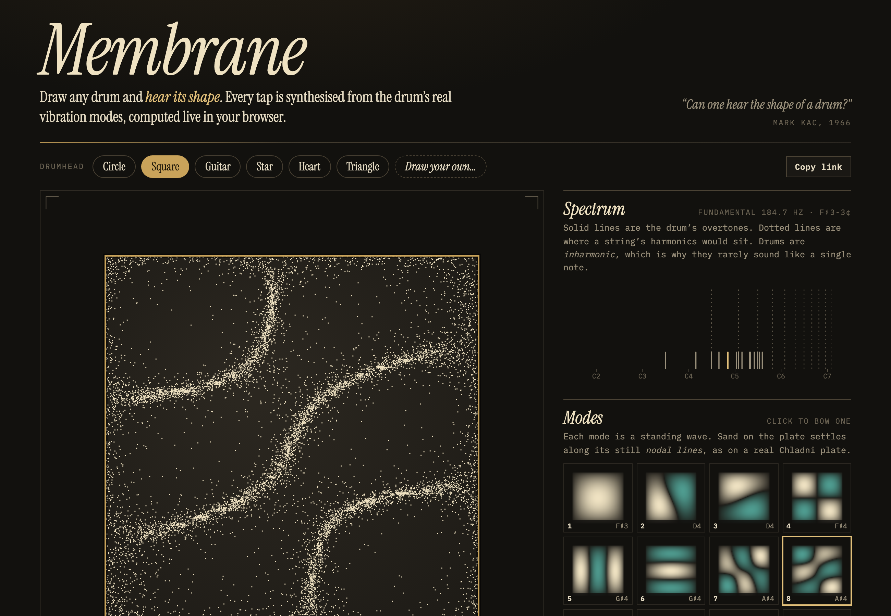

# Membrane

**Hear the shape of a drum: draw any drumhead, strike it, and hear sound synthesised from its real vibration modes, computed live in your browser.**



**[Strike a drum in your browser →](https://thewingthewong.github.io/membrane/)** · no install, no sign-up

*"Can one hear the shape of a drum?"* (Mark Kac, 1966). Pick a drumhead or **draw your own**, then
click anywhere on it to strike it. Membrane solves for the drum's vibration modes on the spot and
builds the sound from them, so a heart, a star and your own scribble each ring differently.
(The answer to Kac's question, by the way, is "not always": in 1992 Gordon, Webb and Wolpert found
two differently shaped drums that sound identical.)

Zero dependencies: plain HTML, CSS, ES modules, Web Workers and Web Audio, with no build step.

## Run it

```sh
npm start            # http://127.0.0.1:8080
```

## How it works

- **Solver (`solver.js`):** the outline is rasterised onto a 64×64 grid, and the clamped-rim
  Laplacian becomes a sparse SPD matrix with about 3,000 rows. A banded Cholesky factorisation plus
  shift-invert block Krylov iteration and Rayleigh–Ritz with cyclic Jacobi find the 24 lowest
  eigenpairs in about 0.2 s, in a Web Worker. Blocks catch repeated eigenvalues (a square drum has many).
- **Sound (`synth.js`):** modal synthesis. Each mode rings at `c·√λ / 2π·size`, its amplitude
  is the mode's displacement at the strike point (strike a nodal line and that mode stays silent), the
  mallet hardness rolls off high modes, and higher modes decay faster.
- **Chladni sand:** 12,000 grains bounce in proportion to the local vibration amplitude, so they
  collect on the mode's still nodal lines, as on a real Chladni plate. Click any mode to bow it.
- **Spectrum:** the drum's overtones next to a string's harmonic series. Drums are inharmonic.
- **Ear test:** one of three drums is struck unseen, and you guess which. Streaks are counted.
- **Share:** the URL encodes the outline, so a drawn drum can be sent to anyone.
- **Shapes (`shapes.js`):** presets, outline simplification, point-in-polygon rasterisation and the
  compact outline encoding used in share links.

## Test it

```sh
npm test             # solver, synth and shape unit tests (node:test, no install needed)
npm install          # once, for Playwright
npx playwright install chromium
npm run test:e2e     # headless Chromium: strikes, sand, drawing, share links, ear test
```

**Tests check against known physics, not just "doesn't crash":** the square drum matches the exact
discrete spectrum to about 1e-6, including degenerate pairs; the circle's overtones match Bessel zeros
(1 : 1.593 : 2.136 : 2.295); an FFT of the synthesised audio peaks at the modal frequencies; striking
a nodal line silences that mode; and in the browser, sand measurably migrates to nodal lines.
`node scripts/screenshot.mjs` regenerates the screenshot above.

## Limitations

- The drum lives on a **64×64 grid**. Outlines become staircases, so thin necks and sharp points are
  approximated, and very small drawings are rejected or lose detail. Higher modes drift further from the
  smooth-membrane answer than low ones, because the grid's error grows with frequency.
- Only the **24 lowest modes** are computed and 16 are shown. That's plenty for the character of a strike,
  but the bright attack of a real hard-mallet hit is missing.
- The physics is an ideal membrane: linear, no stiffness, no air loading, no coupling to a drum body.
  Real drums (timpani especially) are tuned by exactly those effects, so Membrane sounds like the
  mathematics of the shape rather than any particular instrument.
- Audio starts only after your first click, because browsers block sound until the page is interacted with.

## License

[MIT](LICENSE). The bundled fonts are under the SIL Open Font License 1.1 (see [`fonts/README.md`](fonts/README.md)).
